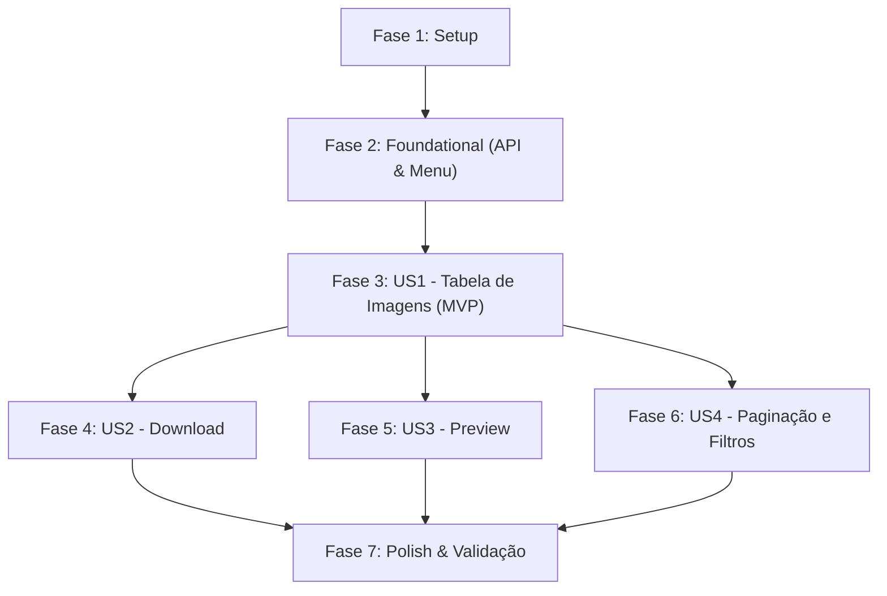

# Tasks: Módulo Dataset de Imagens Cadastradas

**Input**: Documentos de design em `specs/001-list-registered-images/` (`spec.md`, `plan.md`, `data-model.md`, `contracts/`, `research.md`, `quickstart.md`)  
**Prerequisites**: `plan.md`, `spec.md`, `data-model.md`, `contracts/dataset-api.json`  
**Constitution**: Todas as tarefas e documentações redigidas em português; código em TypeScript e interfaces em pt-BR.  

## Formato: `[ID] [P?] [Story] Descrição com caminho do arquivo`

- **[P]**: Tarefa executável em paralelo (arquivos distintos, sem dependência bloqueante)
- **[Story]**: Identificador da história de usuário associada (ex: `[US1]`, `[US2]`, `[US3]`, `[US4]`)
- Todos os itens incluem caminhos exatos dos arquivos

---

## Phase 1: Setup (Infraestrutura Básica)

**Objetivo**: Inicialização de diretórios e tipagens centrais do módulo

- [X] T001 Criar o diretório do módulo administrativo em `src/app/admin/dataset`
- [X] T002 [P] Declarar as interfaces e tipos TypeScript (`DatasetUser`, `DatasetItem`, `DatasetFilter`) em `src/services/dataset.ts`

---

## Phase 2: Foundational (Serviço de API e Navegação)

**Objetivo**: Infraestrutura bloqueante que dá suporte a todas as histórias de usuário

- [X] T003 Implementar a função `getAll` do serviço `DatasetServices` em `src/services/dataset.ts` utilizando a instância do Axios de `src/services/api.ts` com parâmetros de URL (`page`, `name`, `email`, `type`)
- [X] T004 [P] Adicionar o item "Dataset" com link para `/admin/dataset` no menu lateral em `src/themes/components/menu.tsx`
- [X] T005 Criar o Server Component de entrada da página em `src/app/admin/dataset/page.tsx` configurando o container `AppMainContainer` e os metadados da rota

**Checkpoint**: Fundação pronta - serviço e rotas base configurados para integração das histórias de usuário

---

## Phase 3: User Story 1 - Visualização da Tabela de Imagens (Priority: P1) 🎯 MVP

**Objetivo**: Exibir a listagem das imagens cadastradas em tabela com as colunas essenciais (Data Envio, Usuário, Imagem, Tipo, Confiança, Classificação)

**Critério de Teste Independente**: Acessar `/admin/dataset` e verificar se a tabela é renderizada com todos os dados preenchidos a partir da API, exibindo o percentual de confiança e o badge de classificação

- [X] T006 [US1] Criar o Client Component `_list.tsx` em `src/app/admin/dataset/_list.tsx` integrando a busca de dados via `DatasetServices.getAll`, controle de estado com `useState`/`useEffect` e indicador de carregamento (`AppLoader`)
- [X] T007 [US1] Implementar a estrutura da tabela em `src/app/admin/dataset/_list.tsx` renderizando as colunas Data Envio (`created_at`), Usuário (`name` e `email`), Imagem (miniatura), Tipo (`type`), Confiança (`assurance%`) e Classificação (badge Positivo/Negativo)
- [X] T008 [US1] Adicionar tratamento de estado vazio em `src/app/admin/dataset/_list.tsx` exibindo mensagem amigável em português quando nenhuma imagem for retornada

**Checkpoint**: User Story 1 funcional de forma independente como MVP

---

## Phase 4: User Story 2 - Download da Imagem Cadastrada (Priority: P1)

**Objetivo**: Permitir o download direto do arquivo original de cada imagem em alta resolução com um clique

**Critério de Teste Independente**: Clicar na ação de download de uma linha da tabela e verificar se o arquivo original é transferido com êxito

- [X] T009 [US2] Adicionar a coluna de Ações na tabela com botão/ícone de download para cada linha em `src/app/admin/dataset/_list.tsx`
- [X] T010 [US2] Implementar função de download da imagem a partir da `image_url` em `src/app/admin/dataset/_list.tsx` com tratamento amigável de erros

**Checkpoint**: User Story 2 integrada e testável em conjunto com o MVP

---

## Phase 5: User Story 3 - Pré-visualização Ampliada da Imagem (Priority: P2)

**Objetivo**: Permitir inspeção rápida da imagem ampliada em modal sem necessidade de download prévio

**Critério de Teste Independente**: Clicar sobre a miniatura da imagem na tabela e validar a abertura do modal (`AppModal`) exibindo a foto em tamanho destacado

- [X] T011 [US3] Integrar modal de pré-visualização de imagem (`AppModal`) em `src/app/admin/dataset/_list.tsx`, acionado ao clicar na miniatura da imagem

**Checkpoint**: User Story 3 funcional sem quebrar o fluxo de listagem e download

---

## Phase 6: User Story 4 - Paginação e Filtros de Busca (Priority: P3)

**Objetivo**: Fornecer filtros combinados (Nome, Email, Tipo) e controle de paginação de 10 em 10 itens

**Critério de Teste Independente**: Preencher os campos de filtro, clicar em Filtrar e conferir a atualização dos resultados, além de navegar pelas páginas anterior/próxima

- [X] T012 [US4] Adicionar os inputs de filtro para Nome (`name="name"`), Email (`name="email"`) e select para Tipo (`name="type"` com opções `cancer`, `qa`, `eritroplasia`, `leucoplasia`) em `src/app/admin/dataset/_list.tsx`
- [X] T013 [US4] Implementar a barra de navegação com botões "Anterior" e "Próximo" para paginação de 10 em 10 itens em `src/app/admin/dataset/_list.tsx`
- [X] T014 [US4] Conectar a ação do botão "Filtrar" em `src/app/admin/dataset/_list.tsx` para disparar a consulta à API com os filtros ativos e reiniciar a paginação na página 1

**Checkpoint**: Todas as 4 histórias de usuário concluídas e integradas

---

## Phase 7: Polish & Cross-Cutting Concerns

**Objetivo**: Refinamento de qualidade, padronização de código e validação final

- [X] T015 [P] Executar checagem de tipos estáticos com TypeScript e validação de lint com ESLint garantindo ausência de erros
- [X] T016 Executar validação de todos os cenários operacionais descritos em `specs/001-list-registered-images/quickstart.md`

---

## Dependências e Ordem de Execução

### Dependências entre Fases

- **Setup (Fase 1)**: Sem dependências, inicia imediatamente
- **Foundational (Fase 2)**: Depende da Fase 1 - BLOQUEIA todas as histórias de usuário
- **User Story 1 (Fase 3)**: Depende da conclusão da Fase 2 (Foundational)
- **User Story 2 (Fase 4)**: Depende da Fase 3 (adiciona a coluna de ação na tabela existente)
- **User Story 3 (Fase 5)**: Depende da Fase 3 (adiciona a interação de clique na miniatura)
- **User Story 4 (Fase 6)**: Depende da Fase 3 (adiciona o formulário de filtros e os controles de paginação)
- **Polish (Fase 7)**: Depende da conclusão de todas as histórias de usuário

---

## Oportunidades de Execução Paralela

- `T002` pode rodar em paralelo com `T001` na Fase 1.
- `T004` (Menu) pode ser implementado em paralelo com `T003` (Serviço) na Fase 2.
- `T015` (Lint e validação de tipos) pode rodar em paralelo ao final antes do checklist de fechamento.

---

## Estratégia de Implementação (Entrega Incremental)

1. **MVP (Fases 1, 2 e 3)**:
   - Configura serviço, menu e tabela funcional com colunas essenciais.
   - Valida a renderização e o consumo real dos dados da API.
2. **Incremento 1 (Fase 4)**:
   - Adiciona o download das imagens originais.
3. **Incremento 2 (Fase 5)**:
   - Adiciona a pré-visualização ampliada via modal.
4. **Incremento 3 (Fase 6)**:
   - Adiciona os filtros de busca e o controle de paginação.
5. **Finalização (Fase 7)**:
   - Validação dos cenários ponta a ponta com `quickstart.md`.
